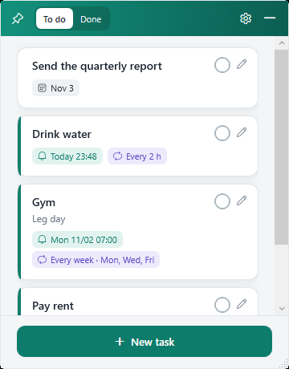
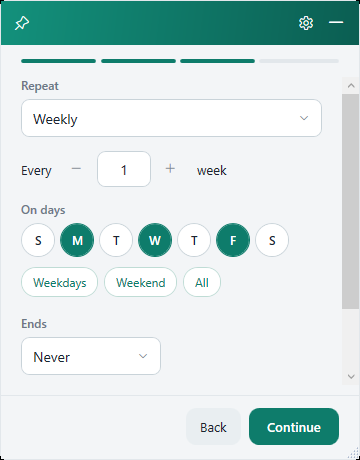
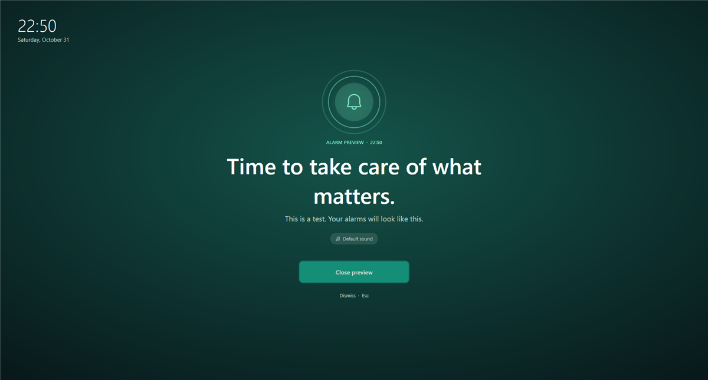
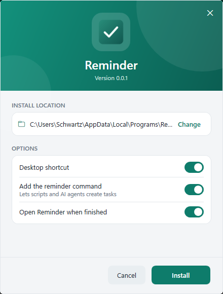

# Reminder

A small desktop widget for Windows that keeps your to-do list in view and rings a full-screen alarm at the right time. It's a native WPF app (.NET 10) in English, Spanish and Portuguese.

<p>
  
  
</p>



## Features

- Tasks with an optional due date, alarm and repeat rule: every N hours, days, weeks (pick the weekdays), months or years, with an optional end date.
- A full-screen alarm with your own song, or a random one from a folder. You can complete, snooze 5/10/30 minutes or dismiss.
- Alarms are registered with the Windows Task Scheduler (after you agree), so they fire even when the widget is closed.
- The widget can float on top of other windows or behave like a normal window. It hides to the tray.
- A command-line interface so scripts and AI agents can manage tasks.

## Install

Download `ReminderSetup-<version>.exe` from [Releases](https://github.com/DarlanSchwartz/Reminder/releases) and run it. It installs for the current user (no admin rights) to `%LocalAppData%\Programs\Reminder`. Remove it from **Settings → Apps**.



Reminder needs the [.NET 10 Desktop Runtime](https://dotnet.microsoft.com/download/dotnet/10.0). The installer tells you if it's missing.

Each release also has a portable zip. Unzip it anywhere and run `Reminder.exe`.

## Command line

To put `reminder` on your PATH, use the installer's **Add the reminder command** option, or click **Add reminder command to PATH** in the widget's settings menu (click it again to remove it). Terminals opened afterwards can run it. If the app is open, the widget updates right away.

```powershell
reminder add "Pay rent" --at "2026-11-05 09:00" --every month --until 2027-06-05
reminder add "Gym" --at 07:00 --every week --days mon,wed,fri
reminder list --json
reminder done 3fa2c1
reminder help
```

Exit codes: `0` success, `1` failure, `2` usage error.

## Data

Tasks live in `data\tasks.json` next to the app. Each save keeps a backup in `tasks.json.bak`.

## Translations

The text lives in one JSON file per language: `Localization\<code>.json` for the app and `Installer\Localization\<code>.json` for the installer. `_language` is the name shown in the menu and `_culture` sets date formats. To add a language, copy `en.json` to a new code, translate the values and rebuild. Any key you leave out falls back to English.

## Build

You need the .NET 10 SDK. Builds are offline, because `NuGet.Config` clears the package sources.

| Command | What it does |
| --- | --- |
| `.\build.ps1` | Publishes the app to `app\` |
| `.\release.ps1` | Builds `dist\ReminderSetup-<version>.exe` and the portable zip |
| `app\Reminder.exe --self-test` | Runs the built-in tests and writes `test-results.txt` |

To release, set `<Version>` in `Reminder.csproj` and `Installer\ReminderSetup.csproj`. Then run `release.ps1` and upload `dist\*` with `gh release create v<version> dist\*`.

## Project layout

| Folder | Contents |
| --- | --- |
| `Models`, `Services` | Tasks, recurrence, storage, the Task Scheduler and PATH setup |
| `Views`, `Themes` | The widget, editor and alarm windows |
| `Audio` | Playback |
| `Cli` | Command-line interface |
| `Localization` | Translations (JSON) |
| `Installer` | The setup program (.NET Framework 4.8, so it runs before .NET 10 is installed) |
| `Tests` | Self-tests |
